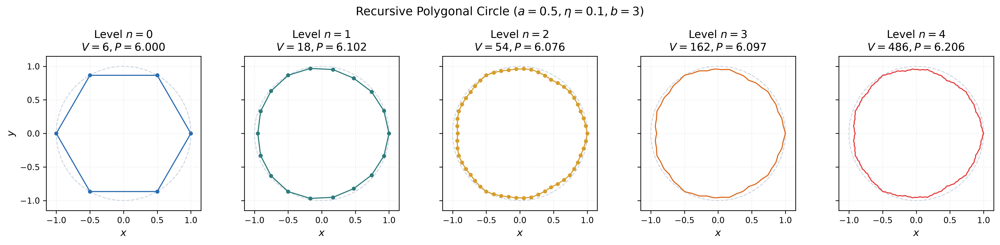
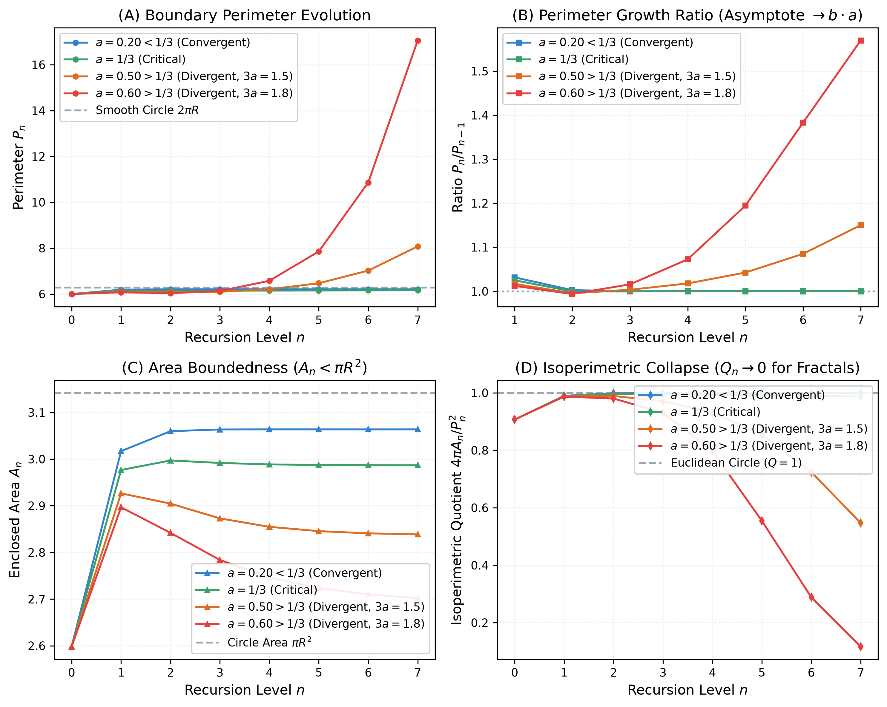
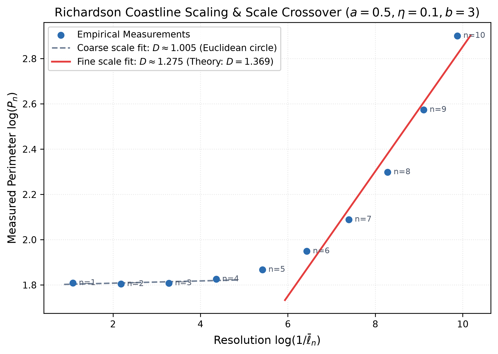
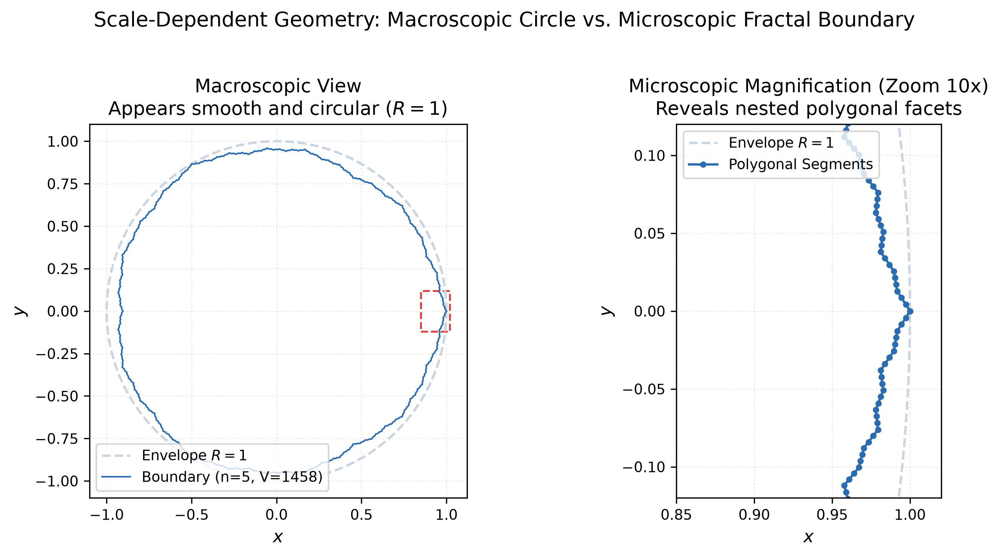
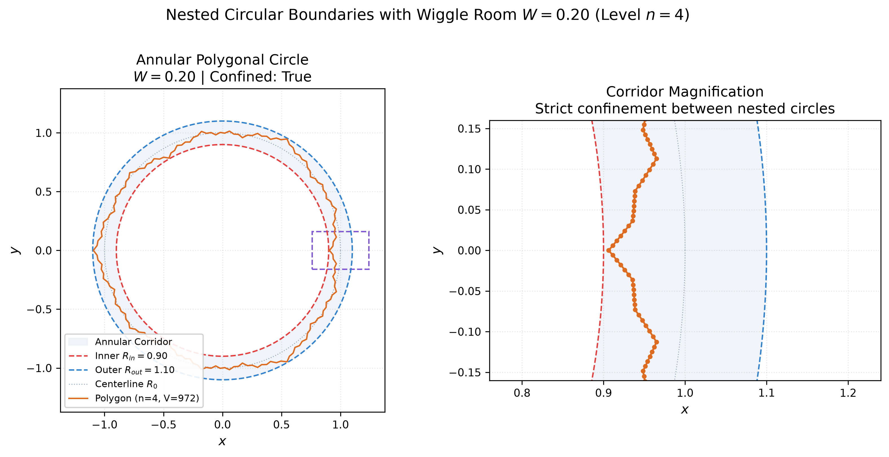
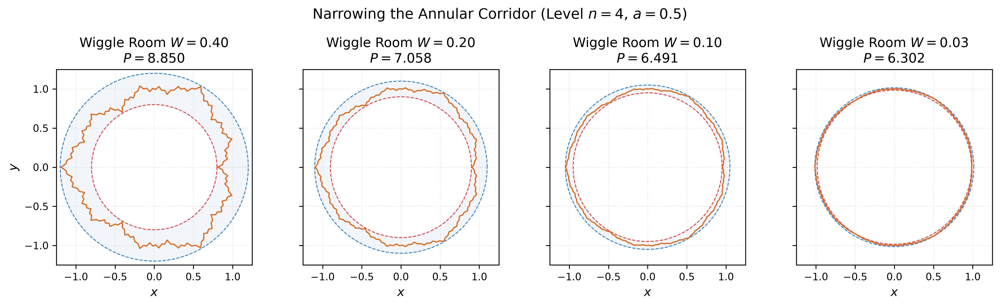
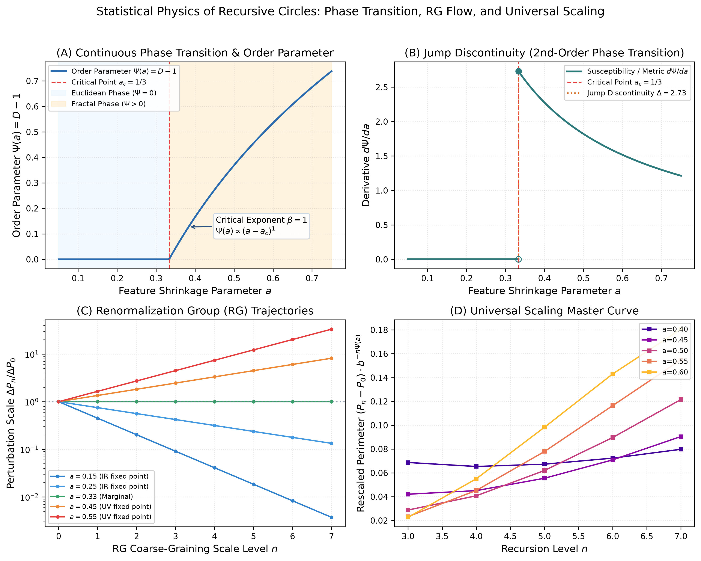
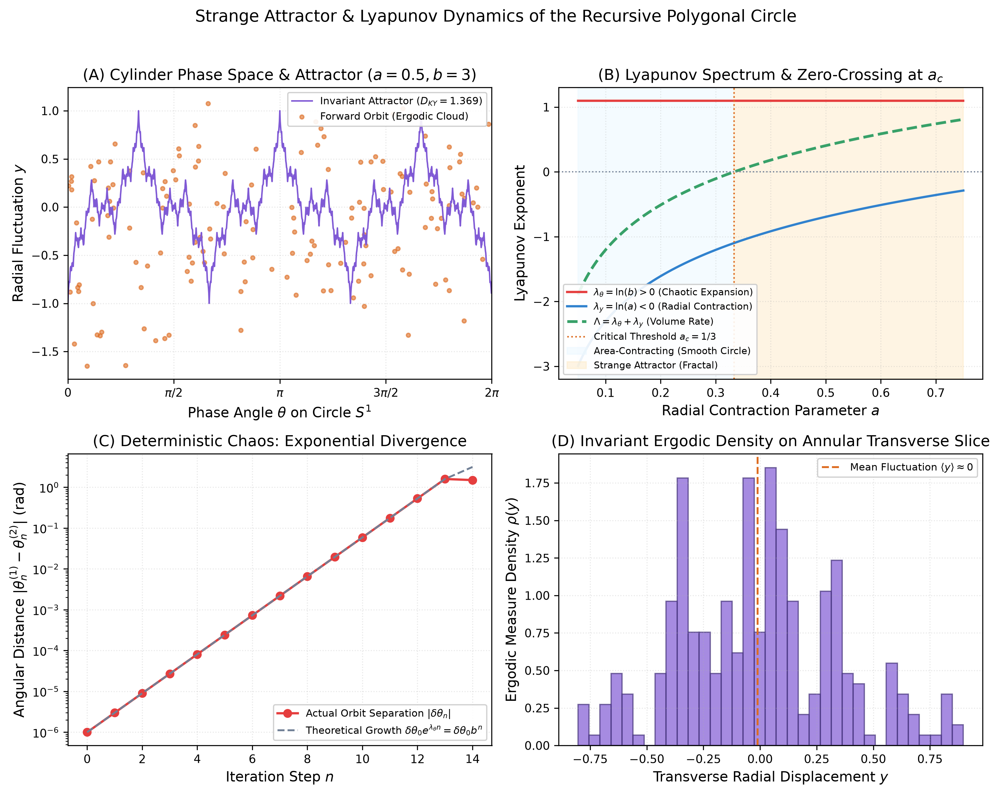

# Polygonal Circle

**First-principles exploration of recursive polygonal circles: circular macroscopic envelopes with scale-dependent fractal boundaries.**

## Overview

Traditional Euclidean geometry treats a circle as a smooth 1D curve with perimeter $P = 2\pi R$ and area $A = \pi R^2$. Traditional fractal geometry typically builds objects like the Koch snowflake by modifying line segments outward/inward, which does not naturally produce a circular macroscopic envelope.

Here, we construct a family of objects from first principles:
- **Circular envelope**: At large scales, the object stays strictly inside a circular disk of radius $R$.
- **Polygonal boundary**: At any finite stage $n$, its boundary consists of straight segments connecting exact breakpoints.
- **Recursive structure**: Each stage introduces finer radial features at higher spatial frequencies.
- **Scale relationship**: We evaluate the exact perimeter $P_n$, area $A_n$, isoperimetric defect, Richardson coastline dimension, and box-counting dimension across levels.

### The Mathematical Construction

The distance from the origin to the boundary at angle $\theta \in [0, 2\pi)$ and recursion depth $n$ is:

$$r_n(\theta) = R \left[ 1 - \eta \sum_{k=1}^n a^k \phi\left( \frac{b^k \theta}{2\pi} \right) \right]$$

where:
- $R$: radius of the reference circular envelope ($R = 1.0$)
- $n$: recursive refinement level ($n = 0, 1, 2, \dots$)
- $\eta$: global irregularity amplitude ($\eta \in [0, 1)$)
- $a$: shrinkage rate of radial deviations per level ($a > 0$)
- $b$: spatial frequency multiplier per level (default $b = 3$)
- $\phi(u)$: repeating triangular wave with range $[0, 1]$ and period $1$.

Because $\phi \ge 0$, $r_n(\theta) \le R$ for all $\theta$, guaranteeing all vertices lie within the disk of radius $R$. By convexity of the disk, the straight polygonal segments connecting the vertices also lie strictly within the circular envelope.

### Scaling Regimes

Rough scaling predicts the boundary contribution at level $n$ scales as $(b a)^n$:
- **$a < 1/b$ (e.g. $a < 1/3$)**: Deviations shrink faster than frequency grows $\implies$ perimeter converges to a finite limit. Euclidean-like rectifiable curve.
- **$a = 1/b$ (e.g. $a = 1/3$)**: Critical threshold $\implies$ perimeter exhibits marginal logarithmic/constant growth increments.
- **$a > 1/b$ (e.g. $a = 1/2$)**: Irregularity frequency dominates $\implies$ perimeter diverges ($P_n \to \infty$) while enclosed area $A_n$ remains strictly bounded $\implies$ non-rectifiable fractal curve with Hausdorff dimension $D > 1$.

## Installation

```bash
conda create -n polygonal-circle python=3.12 -y
conda activate polygonal-circle
pip install -e .
```

## CLI Usage

The package provides the `polygonal-circle` command-line tool:

```bash
# 1. Inspect exact geometric metrics across recursion levels
polygonal-circle inspect -R 1.0 --eta 0.1 -a 0.5 -b 3 -L 6

# 2. Compare behavior across the three scaling regimes (a < 1/3, a = 1/3, a > 1/3)
polygonal-circle regimes -L 7

# 3. Test Richardson coastline scaling and box-counting dimensions against theory
polygonal-circle dimensions -L 9

# 4. Annular polygonal circles confined between two nested circles
polygonal-circle annulus -R 1.0 -W 0.20 -a 0.5 -L 5

# 5. Sweep the corridor width knob ("wiggle room") from wide to razor-thin
polygonal-circle wiggle-sweep -R 1.0 -L 4

# 6. View the exact statistical physics phase diagram and RG eigenvalues
polygonal-circle phase-transition -b 3

# 7. View the skew-product dynamical system and Lyapunov spectrum
polygonal-circle attractor -b 3

# 8. Generate publication-quality figures
polygonal-circle plot -o assets
```

## Visualizations

### 1. Multi-Level Shape Evolution


### 2. Scaling Regimes Comparison


### 3. Richardson Coastline Dimension & Scale Crossover


### 4. Macroscopic Circle vs. Microscopic Fractal Facets


### 5. Annular Polygonal Circle (Nested Circular Boundaries)


### 6. Wiggle Room Knob Sweep (Narrowing Annular Corridor)


### 7. Phase Transition, Renormalization Group, & Universal Scaling


### 8. Strange Attractor & Lyapunov Dynamics


## Empirical Findings & Theoretical Proofs

- See [PHASE_TRANSITIONS_AND_RENORMALIZATION.md](PHASE_TRANSITIONS_AND_RENORMALIZATION.md) for the statistical physics dictionary, mathematical proofs, and RG derivations.
- See [STRANGE_ATTRACTORS_AND_DYNAMICS.md](STRANGE_ATTRACTORS_AND_DYNAMICS.md) for the skew-product cylinder map, Lyapunov spectrum, and Kaplan–Yorke dimension.

1. **Deterministic Chaos & The Lyapunov Spectrum**:
   - The angular coordinate follows a chaotic expanding Bernoulli shift with positive Lyapunov exponent $\lambda_\theta = \ln b > 0$ (exponential orbit separation $\delta \theta_n = \delta \theta_0 b^n$).
   - The radial coordinate undergoes uniform contraction with negative Lyapunov exponent $\lambda_y = \ln a < 0$.
   - When radial contraction dominates ($\lambda_\theta + \lambda_y < 0 \iff a < 1/b$), the invariant attractor is a smooth 1D Euclidean circle ($D = 1$).
   - When chaotic angular stretching overpowers radial contraction ($\lambda_\theta + \lambda_y > 0 \iff a > 1/b$), the invariant manifold becomes a strange fractal attractor with Kaplan–Yorke dimension $D_{KY} = 1 + \frac{\lambda_\theta + \lambda_y}{\lambda_\theta} = 1 + \frac{\ln(ba)}{\ln b}$.
2. **Continuous (Second-Order) Phase Transition**: The excess fractal dimension $\Psi(a) = D(a) - 1$ acts as an exact order parameter, continuous everywhere, with a linear critical exponent $\beta = 1$ ($\Psi \propto (a - a_c)^1$) and a finite jump discontinuity in the derivative $\Delta(d\Psi/da) = b / \ln b \approx 2.7307$ at $a_c = 1/3$.
3. **Renormalization Group (RG) Fixed Points**:
   - $a < 1/3$: Eigenvalue $\lambda = 3a < 1$ (irrelevant operator). Trajectories flow to the stable Infrared (IR) fixed point: the smooth Euclidean circle.
   - $a = 1/3$: Marginal operator ($\lambda = 1$). Constant arithmetic perimeter increments $\Delta P \approx 0.006$ per scale.
   - $a > 1/3$: Relevant operator ($\lambda = 3a > 1$). Flows to the Ultraviolet (UV) non-rectifiable fractal boundary.
4. **Envelope Confinement**: At all levels $n$, $r_n(\theta) \le R$ and all polygonal edges remain strictly inside the circular disk.
5. **Perimeter Divergence**: For $a = 0.50$, the perimeter grows from $6.000$ at $n=0$ to $26.118$ at $n=11$, with the growth ratio $P_{n+1}/P_n \to 3a = 1.500$.
6. **Area Boundedness**: The enclosed area converges to $A_\infty \approx 2.837 < \pi R^2 \approx 3.14159$.
7. **Scale Crossover**:
   - Coarse scale fit ($n=1\dots 4$): $D \approx 1.005$ (looks like a standard Euclidean circle).
   - Fine scale fit ($n=7\dots 11$): $D \approx 1.365$ (converges to theoretical dimension $D = 1 + \log(1.5)/\log(3) \approx 1.369$).
8. **Isoperimetric Collapse**: The isoperimetric quotient $Q = 4\pi A / P^2$ collapses towards $0$ as $n \to \infty$, demonstrating the transition from Euclidean circle to fractal boundary.

## Testing

```bash
pytest tests/
```

